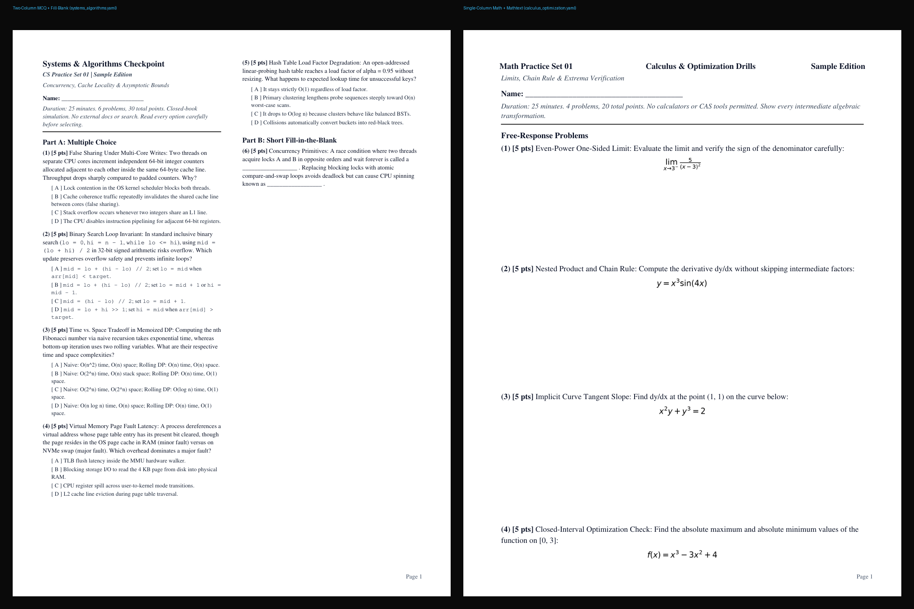
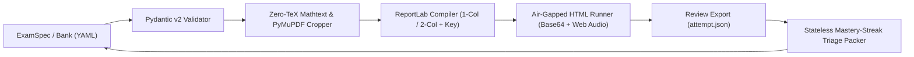

# Strata (`strata-exam`)

**Declarative assessment compiler that builds print-ready PDF exams, air-gapped offline HTML timed runners, and mastery-streak triage sets from a single YAML manifest.**

[](https://github.com/prasiddhadshrestha/strata/actions/workflows/ci.yml)
[](https://prasiddhadshrestha.github.io/strata/)
[](#10-second-quickstart)
[](LICENSE)

> **Try it in your browser (zero install):** [Open Live Compiled Timed Runner Demo](https://prasiddhadshrestha.github.io/strata/) (compiled directly from `examples/systems_algorithms.yaml`)

Flashcard apps drop the two constraints that actually decide hard technical exams: spatial paper layout (multi-step derivations alongside diagrams) and strict countdown isolation without tabs or assistants. Strata treats practice exams like compiled build artifacts generated deterministically from plain YAML.



---

## System Architecture



### Core Capabilities
* **One Schema, Three Question Types:** Pydantic v2 validation for `free_response` (configurable blank workspace), `mcq` (with optional distractor notes), and `fill_blank`, plus automatic Courier rendering for inline `` `code` `` spans.
* **True 1-Column & 2-Column Print PDFs:** ReportLab `BaseDocTemplate` frames with automatic image width clamping, optional detach-ready Answer Key pages, and optional `--solutions` Annotated Solutions PDFs.
* **Zero-TeX Equation Rendering + PDF Diagram Cropping:** Renders `math:` and `$$...$$` expressions at 300 DPI via `matplotlib.mathtext` (no local TeX Live / MiKTeX install required) and extracts normalized `[x0, y0, x1, y1]` regions from reference PDFs via PyMuPDF.
* **Air-Gapped Single-File HTML Runner:** Embeds Base64 PDF pages with exact print parity, withholds Answer Key pages and inline solutions until explicitly revealed, runs a drift-free `Date.now()` wall-clock countdown with synthesized Web Audio API warning chimes (5m, 1m, finish), defaults all items to `ungraded` to prevent silent telemetry corruption, and exports `attempt.json`.
* **Stateless Mastery-Streak Triage (`strata triage`):** Reads YAML banks and `attempt.json` logs without a hidden database, resolves relative figure paths portably, scores topic `tags` by miss/partial weight and recency, marks tags `mastered` after a configurable consecutive pass streak (default `2`), and packs a targeted micro-exam fitting `--minutes`.

---

## Engineering Tradeoffs & Decision Log

| Design Choice | Alternative Rejected | Why Strata Chose This |
| :--- | :--- | :--- |
| **ReportLab + `matplotlib.mathtext`** | Requiring local `pdflatex` / TeX Live | Eliminates multi-GB TeX install friction across Windows/macOS/Linux while caching 300 DPI equations by SHA-256 hash. |
| **Base64 PDF-Parity HTML Runner** | Re-rendering questions as separate HTML DOM | Guarantees exact visual parity between printed sheets and timed screen sessions with zero external CDNs. |
| **ReportLab `_SectionSentinel` Flowable** | Guessing answer key page indices | Records the exact page boundary where the Answer Key begins so key pages are deterministically withheld until revealed. |
| **Wall-Clock `Date.now()` Deadline** | Naive 1-second `setInterval` decrements | Prevents timer drift when browser tabs sleep or throttle, and locks the timer cleanly at `00:00` until Reset. |
| **Stateless JSON/YAML Triage** | Hidden local SQLite state database | Keeps problem banks and `attempt.json` telemetry plain-text, inspectable, and Git-friendly with reproducible scoring. |

---

## Verified Benchmarks

Measured locally on Windows (`Python 3.12.13`, median of 5 runs via `scripts/generate_assets.py`):

| Benchmark Workload | Problems | Output Pages (Exam + Key) | PDF Build (ms) | Runner Build (ms) | Total (ms) | Artifact Sizes |
| :--- | :---: | :---: | :---: | :---: | :---: | :--- |
| `examples/systems_algorithms.yaml` *(2-col MCQ + FIB + Solutions)* | 6 | 1 + 1 | 129.0 ms | 351.4 ms | **467.3 ms** | 6.5 KB PDF / 556.0 KB HTML |
| `examples/calculus_optimization.yaml` *(1-col Free-Response + 300 DPI Mathtext)* | 4 | 2 + 1 | 238.7 ms | 352.3 ms | **594.0 ms** | 26.7 KB PDF / 288.7 KB HTML |

### Triage Verification (`examples/attempts/`)
Running `strata triage` across the 10-problem combined bank and 2 sample `attempt.json` logs:
* **Mastered (Cleared via 2-pass streak):** `boundary-condition` (priority dropped to `0.0`)
* **Active Weak Tags Targeted:** `implicit-product`, `sign-flip`, `critical-point-filter`, `even-power-sign`, `one-sided-limit`, `concurrency-race`, `systems-vocab`
* **Packed Output:** `["calc-03", "calc-01", "sys-04"]` (`14.0 min` within `15 min` budget)

---

## 10-Second Quickstart

```bash
# 1. Install dependencies with uv
uv sync --dev

# 2. Validate an exam manifest
uv run strata validate examples/systems_algorithms.yaml

# 3. Compile print PDF, offline HTML runner, and Annotated Solutions PDF
uv run strata build examples/systems_algorithms.yaml --out out/sys --solutions
uv run strata build examples/calculus_optimization.yaml --out out/calc

# 4. Generate a 15-minute targeted review exam from attempt telemetry
uv run strata triage \
  --bank examples/calculus_optimization.yaml \
  --bank examples/systems_algorithms.yaml \
  --attempts examples/attempts \
  --minutes 15 \
  --out out/triage

# 5. Crop a diagram region from any PDF (normalized x0,y0,x1,y1 ratios)
uv run strata crop path/to/source.pdf --page 0 --bbox 0.15,0.20,0.85,0.55 --out fig.png

# 6. Run test suite and linter
uv run pytest -v
uv run ruff check src tests scripts
```

---

## Repository Layout

```text
strata/
├── .github/workflows/ci.yml       # Ruff + Pytest + CLI smoke CI
├── .gitattributes                 # Cross-platform LF normalization
├── docs/assets/preview.png        # Generated dual-layout sample render
├── examples/                      # Synthetic CS & Calculus specs + attempt JSONs
├── scripts/generate_assets.py     # Benchmark & README preview generator
├── src/strata/
│   ├── cli.py                     # Typer CLI (validate, crop, build, triage)
│   ├── crop.py                    # PyMuPDF normalized region extractor
│   ├── math_render.py             # SHA-256 cached matplotlib.mathtext renderer
│   ├── models.py                  # Pydantic v2 ExamSpec & AttemptRecord schemas
│   ├── pdf_builder.py             # ReportLab 1-col / 2-col Frame & Solutions compiler
│   ├── runner_builder.py          # Offline HTML + Web Audio timer + Review Drawer
│   └── triage.py                  # Stateless tag scorer & greedy time packer
└── tests/                         # Unit, regression, integration, and CLI test suite
```

## License

MIT License. See [LICENSE](LICENSE).
